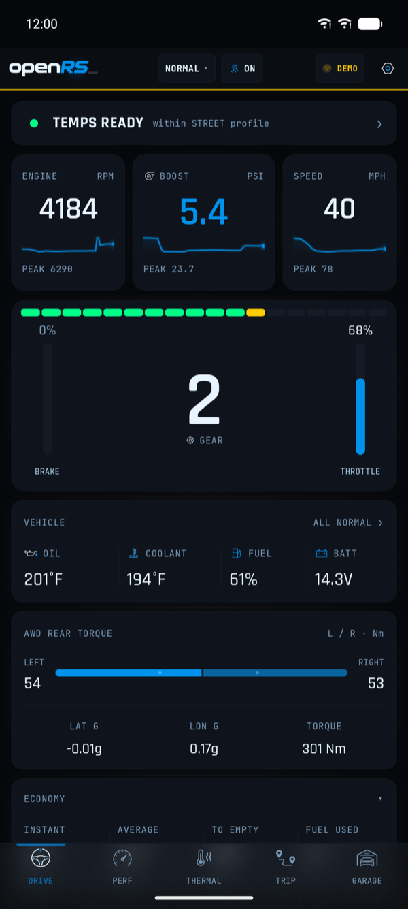
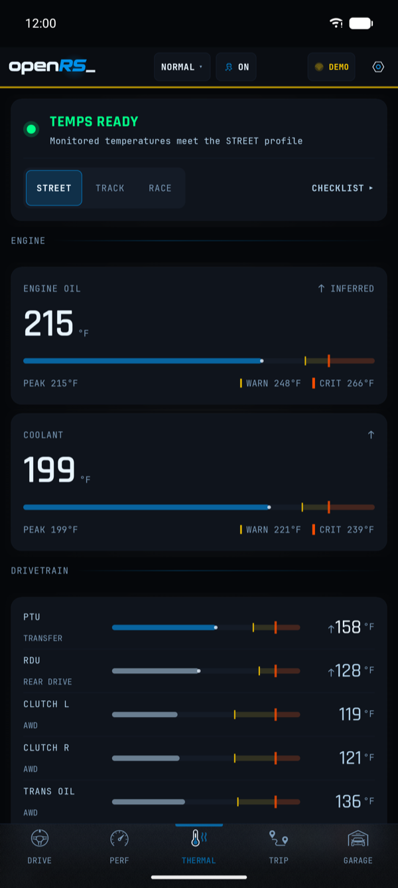
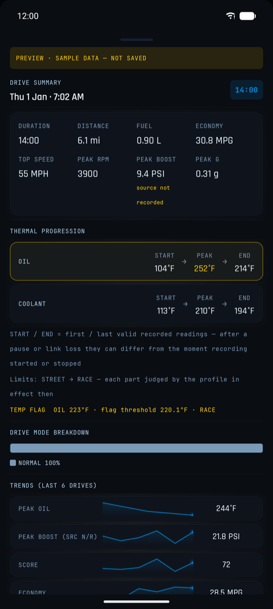
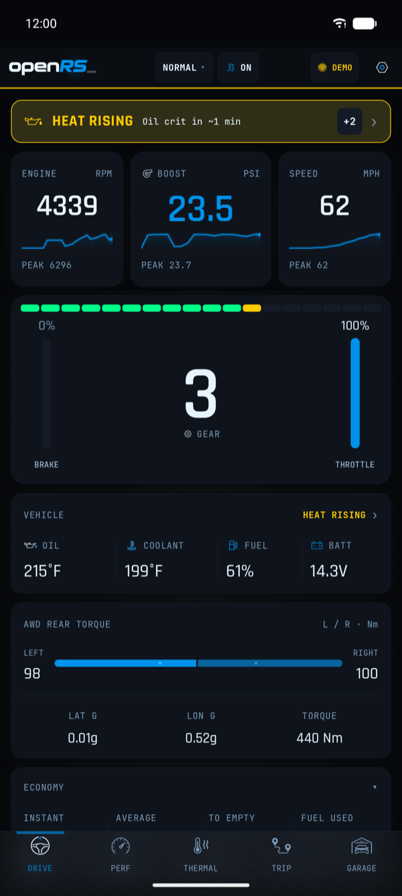
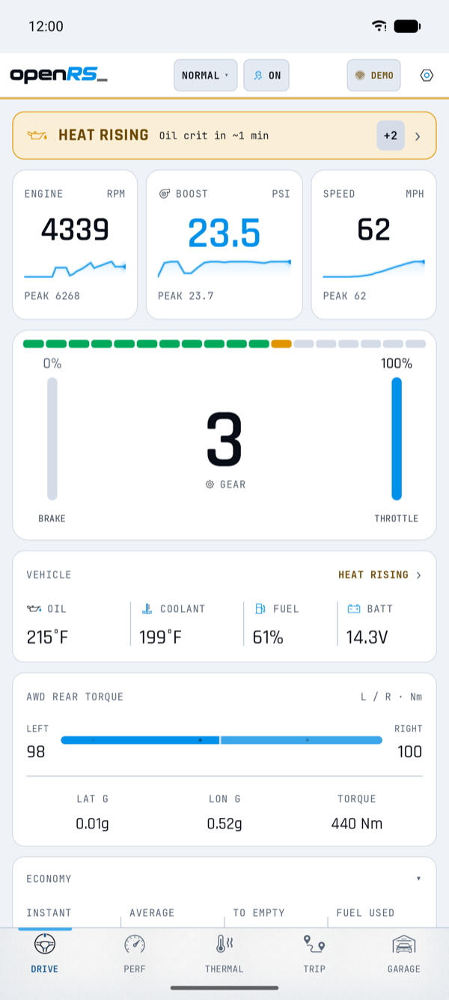
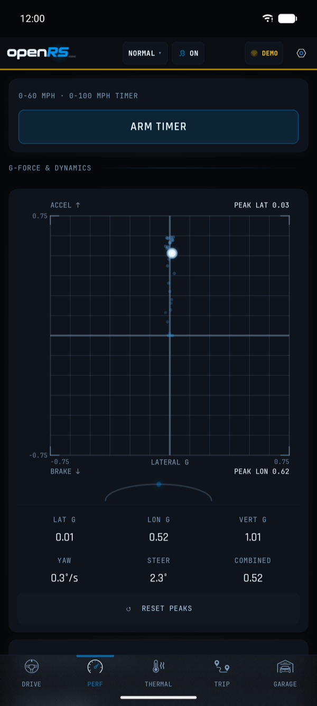
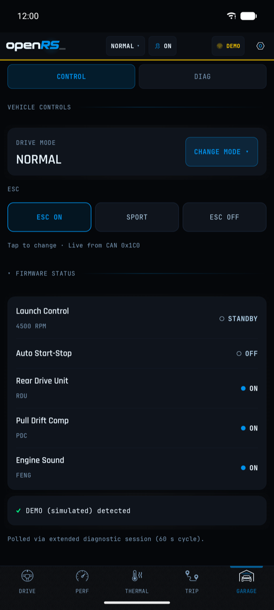

   
  <b>Android telemetry for the Ford Focus RS Mk3.</b>

  <a href="#choose-a-release"><b>Download</b></a> •
  <a href="android/docs/hardware-setup.md"><b>Setup&nbsp;guide</b></a> 
  <a href="https://klexical.github.io/openRS_/emulator/" title="Browser demo of v2.2.6 with simulated data"><b>Demo&nbsp;·&nbsp;v2.2.6</b></a> •
  <a href="https://klexical.github.io/openRS_/" title="Sapphire: session analysis in your browser"><b>Sapphire&nbsp;analysis</b></a>

  
  
  

Stable v2.2.6 · Pre-release v2.2.7-rc.8 (Build 39)

See boost, rear-axle torque, tire pressures and temperatures from your Focus RS. Connect a supported MeatPi adapter over **Wi-Fi on stable v2.2.6**. The [setup guide](android/docs/hardware-setup.md#which-connection-to-use) covers Bluetooth LE on supported release-candidate configurations.

## The v2.2.7 pre-release

<b>v2.2.7-rc.8 (Build 39) · pre-release · simulated data</b>

  
  
  

  DRIVE: the essentials at a glance &nbsp;·&nbsp; THERMAL: is the car warm enough to push? &nbsp;·&nbsp; TRIP: review a drive afterwards

These images show **v2.2.7-rc.8 (Build 39)**, the current pre-release. They were captured from a debug build in its demo
mode on an emulator: the **DEMO** label in the header marks simulated data, and the TRIP summary carries its own
"PREVIEW · SAMPLE DATA — NOT SAVED" banner. Features may still change before the stable release.

<b>More screens</b> (an alert, DAY theme, PERF, GARAGE)

 

<b>v2.2.7-rc.8 (Build 39) · pre-release · simulated data</b>

  
  
   
  
  

An alert on DRIVE: HEAT RISING forecasts a temperature reaching its critical limit &nbsp;·&nbsp; DRIVE in the DAY theme &nbsp;·&nbsp; PERF &nbsp;·&nbsp; GARAGE

The GARAGE screen shows the drive-mode and ESC controls. These need openRS_ adapter firmware, and ESC control from the
app is **not yet confirmed on a car** ([#125](https://github.com/klexical/openRS_/issues/125)).

The stable v2.2.6 screens are in the [app guide](docs/app-guide.md#screens-v226).

## Choose a release

**Stable · v2.2.6** — for most owners 
[Release page](https://github.com/klexical/openRS_/releases/tag/android-v2.2.6) · download `openRS_v2.2.6.apk`

**Pre-release · v2.2.7-rc.8, Build 39** — for testers 
[Release page](https://github.com/klexical/openRS_/releases/tag/android-v2.2.7-rc.8) · download `openRS_v2.2.7-rc.8.apk`

**Stable or pre-release?** Stable is the build most owners should install. A pre-release has newer features and fixes
that have had less time on cars. It is built to install over stable and keep your settings and drives (the same app,
signed the same way, with its database upgraded in place); that upgrade has not yet been checked on a phone, so export
anything you would miss first. In the app, Settings → update channel decides which of the two the updater offers.

Release notes and checksums are on each release page. The channel says how a build is distributed, not that every
feature in it is verified on a car.

## What you can do

The tab names below are those of the v2.2.7 release candidates; the v2.2.6 names are in brackets.

- **Understand the drive.** RPM, boost, speed, pedals, G-forces and AWD rear torque on DRIVE (DASH), with a shift light
  and alerts.
- **Monitor temperatures.** Oil, coolant, PTU, RDU, clutch and transmission temperatures with a Street / Track / Race
  readiness verdict on THERMAL (TEMPS), plus TPMS pressures and temperatures.
- **Review engine and performance data.** AFR, boost target against actual with wastegate duty, knock logging and fuel trims on PERF (POWER).
  Which knock signal belongs to which cylinder is [under investigation](https://github.com/klexical/openRS_/issues/222). The knock logger, the boost sweep and the fuel-trim drift tracker are new
  in the v2.2.7 release candidates.
- **Record and revisit drives.** GPS drive recording with a map, peaks and a drive summary on TRIP (MAP), and export
  to GPX, CSV and a text summary. Lap timing is in the release candidates and so far verified with synthetic GPS only
  ([#237](https://github.com/klexical/openRS_/issues/237)).
- **Investigate diagnostics.** DTC scan and clear across the main modules, a DID prober and a diagnostic export on
  GARAGE (DIAG). The bundled FORScan PID catalog (1,148 entries across 20 modules) is a searchable reference list,
  not a count of signals confirmed on the RS.
- **Explore exported sessions.** Open an export in [Sapphire](#companion-tools) for charts and diagnostics in your
  browser.

Full detail: the [app guide](docs/app-guide.md) (v2.2.6) and the
[changelog on staging](https://github.com/klexical/openRS_/blob/staging/android/CHANGELOG.md) (release candidates).

## Compatibility

| | Supported |
|---|---|
| **Vehicle** | Ford Focus RS Mk3, 2016–2018 (LZ platform, 2.3L EcoBoost) |
| **Phone** | Android 9 or newer, with Wi-Fi or Bluetooth Low Energy |
| **Adapter** | [MeatPi USB (C3)](https://www.mouser.com/ProductDetail/MeatPi/WICAN-USB-C3?qs=rQFj71Wb1eVDX2eEy0FC7A%3D%3D) (Wi-Fi + BLE) or [MeatPi Pro (S3)](https://www.meatpi.com/) (Wi-Fi + BLE, MicroSD) |
| **Adapter firmware** | Stock MeatPi firmware for monitoring, or **openrs-fw** (v1.61 USB, v1.2 Pro) for adapter commands |

Stock firmware works out of the box for passive monitoring. openrs-fw adds the commands behind drive-mode change,
Launch Control, Auto Start-Stop kill and ESC control. What is available, and what has been verified on a car, varies
by feature: ESC control from the app, for example, is not yet confirmed on a car
([#125](https://github.com/klexical/openRS_/issues/125)). See the
[firmware update guide](android/docs/firmware-update.md).

**Which connection?** On stable v2.2.6, connect over **Wi-Fi**: its Bluetooth looks for a service that no MeatPi firmware
provides ([#218](https://github.com/klexical/openRS_/issues/218)). Bluetooth LE needs v2.2.7-rc.7 or later; it has been
seen working on a car with a MeatPi Pro running openrs-fw, and the other combinations are expected to work from the source.
The [hardware setup guide](android/docs/hardware-setup.md#which-connection-to-use) has the details by release, adapter and
firmware.

## Get started

1. **Check your setup** against the [compatibility table](#compatibility).
2. **Choose a release** from the [list above](#choose-a-release). Stable is the right choice for most owners.
3. **Install the app.** Download the APK from the release page on your phone and open it; Android asks you to allow
   installs from your browser or file manager.
4. **Set up the adapter** with the [hardware setup guide](android/docs/hardware-setup.md): plug it into the OBD-II port
   under the steering column, join its Wi-Fi network (it starts with `WiCAN_` or `openRS_`), then pick the adapter and
   the connection method in Settings: Wi-Fi on v2.2.6; Bluetooth LE needs v2.2.7-rc.7 or later and has to be turned on in
   the adapter's web page. A MeatPi Pro must be switched to SLCAN first ([Pro setup](android/docs/hardware-setup.md#meatpi-pro-s3-adapter)).
5. **Connect.** Tap the connection indicator in the header. Once CAN frames arrive the link shows as connected and the
   gauges fill in. If no frames arrive, check the adapter's protocol and port settings in the setup guide.

## Safety and privacy

**Safety.** Set the app up before you drive and do not operate it while driving. openRS_ is a hobby project, not a
Ford product: a reading can be wrong or late, so never rely on it in place of the car's own instruments and warnings.
With openrs-fw, the adapter can send the same messages as the car's own buttons (drive mode, ESC, Auto Start-Stop,
Launch Control) onto the car's CAN bus. You use those commands at your own risk, and what has been verified on a car
varies by feature ([#125](https://github.com/klexical/openRS_/issues/125)).

**Privacy.** There is no account, and the app sends no telemetry or analytics to this project. It reads the car through
the adapter and keeps drives and settings on your phone. It contacts three outside services: GitHub, to check for
updates; Google Maps, to draw the map on the TRIP tab; and OpenWeatherMap for the weather on a drive, only in a build that
was given a weather key (the published builds have none). The phone's own location service supplies the position while a
drive is recorded. Sapphire runs in your browser and uploads nothing; its map loads OpenStreetMap tiles for the area on
screen, which tells that tile server roughly where a drive was, and its fonts come from Google Fonts.

**Before you share an export.** A drive export contains your route: GPS positions and times. A diagnostic export contains
the car's raw CAN traffic and the app's logs. The v2.2.7 release candidates mask the VIN in a diagnostic export
([#260](https://github.com/klexical/openRS_/issues/260)); v2.2.6 does not. Look at what you are about to attach to a
public issue, and leave the drive files out if the route is private.

## Reporting a problem

Open an [issue](https://github.com/klexical/openRS_/issues) with the app version (Settings shows it), the adapter and
its firmware, Wi-Fi or Bluetooth, and what you expected against what happened. A diagnostic export helps most (the DIAG
screen; GARAGE → DIAG in the release candidates): read **Before you share an export** above first. A weakness that could affect a car or an adapter goes
through [SECURITY.md](SECURITY.md), not a public issue. Questions and ideas are welcome in
[Discussions](https://github.com/klexical/openRS_/discussions).

## Companion tools

**Browser demo · v2.2.6** — [klexical.github.io/openRS_/emulator](https://klexical.github.io/openRS_/emulator/). The
v2.2.6 interface with animated simulated data, in any browser and with no hardware.

**Sapphire — Session analysis** — [klexical.github.io/openRS_](https://klexical.github.io/openRS_/). After a drive,
export a ZIP from the app and drop it into Sapphire to explore the session: key figures and peaks, time-series charts,
the CAN frame inventory, DID probe results and the decode trace. It runs in your browser and keeps its session library
there (IndexedDB). Source and details: [web/README.md](web/README.md).

## Documentation and help

| I want to… | Go to |
|---|---|
| Set up an adapter (Wi-Fi, Bluetooth LE, MeatPi Pro) | [Hardware setup guide](android/docs/hardware-setup.md) |
| Flash openrs-fw and see what it adds | [Firmware update guide](android/docs/firmware-update.md) |
| Learn the screens, thresholds and settings | [App guide (v2.2.6)](docs/app-guide.md) |
| Look up CAN frames, Mode 22 PIDs and formulas | [Telemetry reference](android/docs/pid-reference.md) |
| Analyse an exported session | [Sapphire](https://klexical.github.io/openRS_/) · [web/README.md](web/README.md) |
| Fix a problem | [Connection settings](android/docs/hardware-setup.md) · [Firmware flashing troubleshooting](android/docs/firmware-update.md#troubleshooting) |
| Report a problem | [Reporting a problem](#reporting-a-problem) · [Issues](https://github.com/klexical/openRS_/issues) · [Security](SECURITY.md) |
| Build the app or contribute | [Contributing](CONTRIBUTING.md) |
| Understand the code and the design | [Architecture](docs/architecture.md) · [Brand tokens](docs/brand.md) |
| Follow releases and plans | [Releases](https://github.com/klexical/openRS_/releases) · [Changelog (staging)](https://github.com/klexical/openRS_/blob/staging/android/CHANGELOG.md) · [Feature roadmap](docs/feature-roadmap.md) |

## Development and direction

**Current focus.** The v2.2.7 release candidates: the "Daylight" redesign (five tabs, DAY / NIGHT / AUTO / ULTRA
themes), the knock logger, boost target against actual, the fuel-trim drift tracker, lap timing, corrected oil / PTU
temperature mapping and Bluetooth LE fixes. rc.8 adds diagnostics, reliability and ESC-confirmation fixes; it is the
current pre-release.

**Next priorities.**
- rc.8 polls manifold absolute pressure (MAP, PCM 0xF40B) beside throttle-inlet pressure (TIP) during active drive recording. Whether this PCM answers it, and [validating the TIP scale](https://github.com/klexical/openRS_/issues/271), still need vehicle data.
- Planned PCM work includes barometric pressure, engine load, oil pressure and knock counters.
- Track days: geofenced lap timing, track map overlays and better drive comparison.
- Hardware: position from a GPS accessory on the MeatPi Pro's USB port (the Pro has no GPS receiver of its own), and MS-CAN through a second adapter.
- High-frequency telemetry through a UDS fast-rate session (about 100 Hz).

**Exploring.** Android Auto, streaming data to lap-timing apps such as RaceChrono or Harry's LapTimer, and video
overlay export. None of these is a commitment; the [feature roadmap](docs/feature-roadmap.md) has the full list and
the history of completed phases.

Pull requests are welcome: start with [CONTRIBUTING.md](CONTRIBUTING.md). Owners with FORScan or an OBDLink can help
verify signals on a car; the [Android contributing guide](android/CONTRIBUTING.md#help-verifying-on-a-car) lists what
is needed.

## Credits and license

Thanks to **FORScan** (Ford enhanced PID discovery), **MeatPi** (WiCAN hardware) and the **Focus RS community**
(testing and feedback).

MIT — see [LICENSE](LICENSE).
